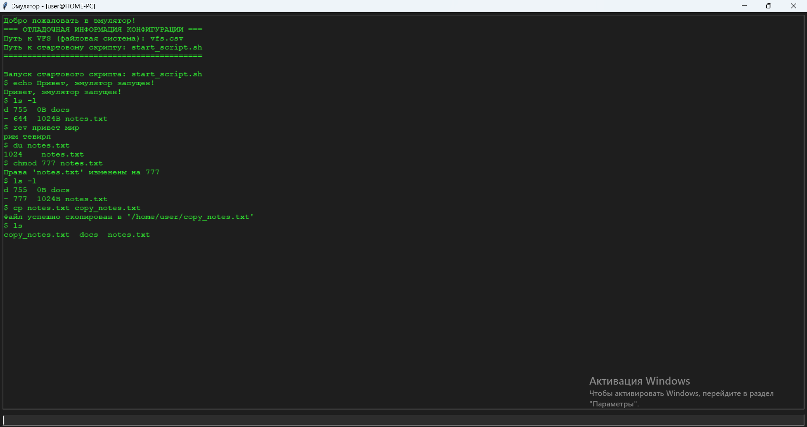

# Эмулятор командной строки UNIX-подобной ОС (Вариант 2)

## 1. Общее описание
Данный проект представляет собой графический эмулятор (GUI) языка оболочки UNIX-подобной операционной системы. 
Приложение имитирует работу интерактивного терминала, выполняя команды над изолированной виртуальной файловой системой (VFS). 

### Особенности реализации:
- **Динамический заголовок окна:** Формируется автоматически на основе системных данных хоста: `Эмулятор - [username@hostname]`.
- **Изолированная среда:** Все изменения в структуре каталогов и файлах происходят исключительно в оперативной памяти эмулятора, не затрагивая реальные файлы на диске.

## 2. Описание всех функций и настроек
Эмулятор поддерживает следующие встроенные команды и механизмы:
- **Раскрытие переменных окружения:** Корректный парсинг и замена системных переменных вида `$VAR` или `${VAR}` (например, `$USERNAME`) на их реальные значения.
- **`ls` / `ls -l`:** Вывод списка элементов текущего каталога. Флаг `-l` активирует длинный формат вывода с отображением типа элемента, прав доступа и размера в байтах.
- **`cd`:** Навигация по виртуальным каталогам (поддерживаются относительные пути, корни `/`, а также переходы `.` и `..`).
- **`echo`:** Вывод строки текста в окно терминала.
- **`rev`:** Разворот переданной текстовой строки задом наперёд.
- **`du`:** Вывод размера указанного файла или суммарного размера каталога со всеми вложенными элементами.
- **`chmod`:** Изменение прав доступа виртуального файла или папки в памяти.
- **`cp`:** Копирование виртуального файла в указанную директорию VFS в памяти.
- **`exit`:** Корректное завершение сессии и закрытие графического окна.

## 3. Описание команд для сборки проекта и запуска тестов

### Параметры запуска приложения:
Программа принимает обязательные аргументы командной строки:
- `--vfs` — путь к CSV-файлу с описанием структуры файловой системы.
- `--script` — путь к текстовому файлу со сценарием автозапуска команд.

### Запуск эмулятора на Windows:
```cmd
run.bat
```

### Запуск модульных тестов:
Для проверки стабильности парсера и команд используется фреймворк `pytest`:
```cmd
python -m pytest
```

## 4. Примеры использования
Ниже представлен результат успешного запуска графического эмулятора и автоматического выполнения встроенного стартового сценария командной строки UNIX-подобной ОС:



